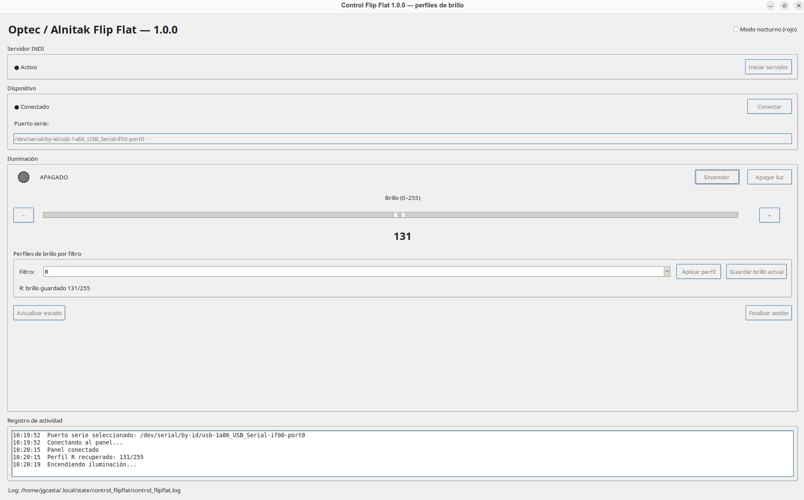
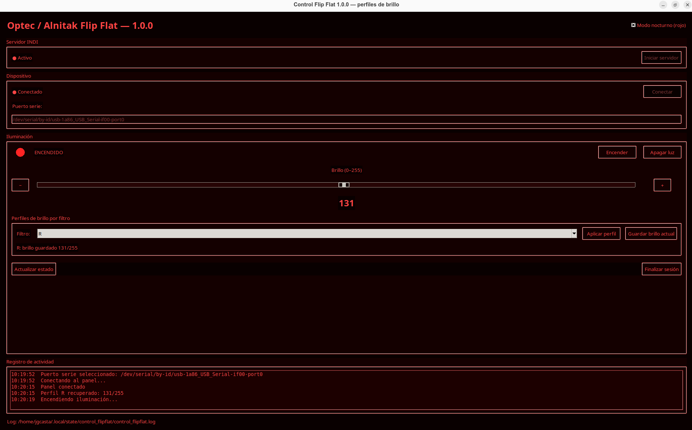

# Control Flip Flat

**Versión 1.0.0** · Aplicación de escritorio para Linux (Ubuntu) · Python / Tkinter / INDI

Control Flip Flat es una interfaz gráfica para gestionar un panel de iluminación **Optec / Alnitak Flip Flat** compatible con el controlador INDI `indi_flipflat`. Está orientada a la captura de *flats* en astronomía y permite controlar la luz, su intensidad y los perfiles de brillo asociados a filtros fotográficos.




## Funcionalidades

- **Ventana maximizada al iniciar**, con posibilidad de restaurar, minimizar y redimensionar, según las capacidades del gestor de ventanas.
- **Detección orientativa del puerto USB serie** al arrancar: prioriza dispositivos en `/dev/serial/by-id/` y adaptadores CH340/CH341; permite modificar manualmente la ruta. La detección **no verifica por sí sola** que el dispositivo encontrado sea el panel.
- Inicio del servidor INDI local (`127.0.0.1:7624`) con el controlador `indi_flipflat`, o reutilización de uno ya existente.
- Conexión al dispositivo **Flip Flat**, encendido y apagado de la luz, consulta de estado e indicador visual.
- Regulación del brillo de **0 a 255**, mediante deslizador y botones de ajuste.
- **Modo nocturno rojo**, activable desde la interfaz.
- **Nueve perfiles de brillo**: L, R, G, B, Hα, O III, S II, Bessel-V y UV/IR.
- Desplegable de filtro, botón **Aplicar perfil** y botón **Guardar brillo actual**.
- Aplicación automática del brillo almacenado al seleccionar un filtro mientras el dispositivo está conectado, y recuperación del perfil seleccionado al conectar.
- Guardado automático del brillo confirmado por INDI en el perfil seleccionado.
- Registro de actividad y errores en un fichero rotativo.
- Finalización de sesión con intento de apagado y desconexión. El programa solo detiene el servidor INDI que haya iniciado él mismo.

## Requisitos

- Ubuntu o distribución Linux con Python 3 y Tkinter.
- INDI con el driver `indi_flipflat` y los comandos `indiserver`, `indi_getprop` e `indi_setprop` disponibles en `PATH`.
- Panel compatible conectado por USB serie y permisos de acceso al dispositivo.

En Ubuntu, una instalación inicial puede ser:

```bash
sudo apt update
sudo apt install python3 python3-tk indi-bin
```

> La disponibilidad del driver `indi_flipflat` depende de los paquetes y repositorios INDI instalados. Compruébalo con `command -v indi_flipflat` antes de ejecutar la aplicación.

## Instalación y ejecución

1. Copia `control_flipflat_1_0_0.py` en el repositorio.
2. Conecta el panel al ordenador.
3. Ejecuta:

```bash
python3 control_flipflat_1_0_0.py
```

La ventana intentará abrirse maximizada. El programa buscará puertos serie USB y propondrá uno cuando pueda identificar un candidato. **Revisa la ruta antes de pulsar Conectar**, especialmente si tienes conectados otros dispositivos USB serie.

Si necesitas localizar el puerto manualmente:

```bash
ls -l /dev/serial/by-id/
ls /dev/ttyUSB* /dev/ttyACM* 2>/dev/null
```

En algunas instalaciones, el usuario debe pertenecer al grupo con permisos para acceder al puerto serie (habitualmente `dialout`).

## Uso básico

1. Comprueba o edita el **puerto serie**.
2. Inicia el servidor INDI y conecta el panel.
3. Selecciona un filtro en el desplegable.
4. Ajusta el brillo con el deslizador o los botones `+` / `−`.
5. Pulsa **Guardar brillo actual** para registrar explícitamente la intensidad leída desde INDI, o utiliza **Aplicar perfil** para restaurar el valor almacenado.
6. Enciende el panel para obtener las tomas de calibración y apágalo al terminar.
7. Finaliza la sesión desde la aplicación.

Los perfiles comienzan sin valores definidos. El brillo adecuado debe determinarse experimentalmente para cada combinación de filtro, cámara y tiempo de exposición; no hay valores universales.

## Archivos de configuración y registro

Los perfiles se guardan en:

```text
~/.config/control_flipflat/profiles.json
```

Ejemplo ilustrativo (los números no son valores recomendados):

```json
{
  "version": 1,
  "selected": "L",
  "values": {
    "L": 140,
    "R": 125,
    "G": 130,
    "B": 155,
    "Hα": 220,
    "O III": 210,
    "S II": 235,
    "Bessel-V": 145,
    "UV/IR": 120
  }
}
```

El registro de ejecución se almacena en:

```text
~/.local/state/control_flipflat/control_flipflat.log
```

## Resolución de problemas

- **No aparece el puerto:** comprueba el cable USB, los permisos y los dispositivos de `/dev/serial/by-id/`. Si hay varios adaptadores, selecciona el correcto manualmente.
- **No conecta INDI:** verifica que `indi_flipflat` está instalado, que el servidor escucha en el puerto TCP `7624` y que el dispositivo está disponible.
- **No cambia el brillo:** comprueba la conexión y las propiedades INDI del dispositivo. El programa necesita que el driver publique `FLAT_LIGHT_INTENSITY`.
- **La ventana no se maximiza:** algunos entornos gráficos, especialmente bajo Wayland, pueden gestionar la maximización de forma distinta.
- **El perfil no se aplica:** verifica que el filtro tiene un valor guardado y que el panel está conectado.

## Limitaciones

La detección del puerto se basa en nombres y cantidad de dispositivos serie disponibles; **no identifica inequívocamente el hardware**. La aplicación está diseñada para el dispositivo INDI denominado `Flip Flat` y las propiedades específicas del driver utilizado. La comunicación real debe verificarse con cada instalación.

## Licencia

**Control Flip Flat 1.0.0 se publica bajo Creative Commons Attribution-ShareAlike 4.0 International (CC BY-SA 4.0).**

Puedes compartir y adaptar el material, incluso con fines comerciales, siempre que atribuyas la autoría, indiques los cambios y distribuyas las adaptaciones bajo la misma licencia, de acuerdo con sus condiciones.

- Texto legal: https://creativecommons.org/licenses/by-sa/4.0/legalcode
- Resumen: https://creativecommons.org/licenses/by-sa/4.0/deed.es
- Identificador SPDX: `CC-BY-SA-4.0`

**Para el repositorio:** añade también un archivo `LICENSE` con el texto íntegro de la licencia y conserva los avisos de atribución pertinentes. Creative Commons recomienda normalmente licencias específicas de software para código fuente; aquí se utiliza CC BY-SA 4.0 por decisión del proyecto.

## Versión

**1.0.0** — Primera versión pública: control INDI del panel, modo nocturno, detección orientativa del puerto, ventana maximizada y perfiles persistentes por filtro.
